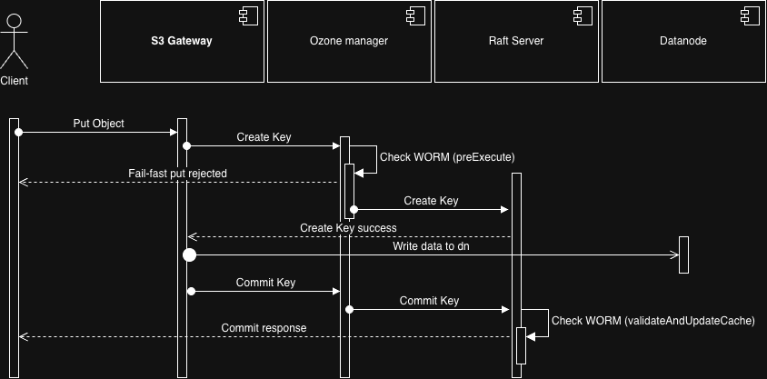

<!--
  Licensed under the Apache License, Version 2.0 (the "License");
  you may not use this file except in compliance with the License.
  You may obtain a copy of the License at

   http://www.apache.org/licenses/LICENSE-2.0

  Unless required by applicable law or agreed to in writing, software
  distributed under the License is distributed on an "AS IS" BASIS,
  WITHOUT WARRANTIES OR CONDITIONS OF ANY KIND, either express or implied.
  See the License for the specific language governing permissions and
  limitations under the License. See accompanying LICENSE file.
-->

# S3 Object Lock Design Doc

## Summary

This design document aims to plan and implement the Object Lock mechanism for OBS buckets, with authorization through Ozone native ACLs or Apache Ranger.
The primary objective is to provide data immutability and tamper-proof protection through the object locking feature.

## Problem statement

With growing demands for data security and compliance, ensuring that critical data stored in Ozone is
protected from accidental or malicious deletion and overwriting has become an essential system protection requirement.
To establish a more rigorous data protection mechanism, we plan to introduce the Object Lock feature.

Considering the current system architecture and access control strategies,
this design supports both Ozone native ACLs and Apache Ranger to manage Object Lock permissions on OBS buckets.
Native ACLs are used by deployments without Ranger and allow the core logic to be implemented and tested independently of the Ranger integration.
Meanwhile, to accelerate core feature delivery, we have decided to exclude complex multi-version locking (Versioning Lock),
Legacy buckets, and FSO buckets from this initial release. Narrowing the scope allows us to focus on the core functionality and ensure a rapid,
stable rollout of baseline tamper-proof protection.

**Goal:**

* Implement the Object Lock feature on standard OBS buckets, with permission and access control through native ACLs or Ranger.
* Support single-version objects only.

## Non-Goal

* Versioning Lock: Support for locking across multiple object versions is deferred (multi-version core features are currently under development).
* Legacy and FSO Buckets: Object Lock support for legacy and FSO buckets is excluded. The following considerations are deferred to a future phase:
  * Lock Granularity: FSO separates files and directories across FileTable and DirectoryTable, requiring explicit policy decisions on whether lock semantics apply at the file level, directory level, or both. 
  * Rename & Move Semantics: Renaming or moving paths alters namespace hierarchy without mutating object content; rules must be defined to either block operations on locked paths or preserve lock metadata across the same objectID
* Value-Level Ranger Authorization: a payload-aware Ranger condition evaluator (for example, allowing a legal hold to be set `ON` but not `OFF`) is deferred to a future phase.

## Differences from AWS

* Single-Version Model: Locks apply to the current key rather than individual object versions. 
* Direct Overwrite Blocking: In AWS S3, a Put, Copy, or MPU request on a locked object writes a new version and leaves the locked version unchanged.
  Because Ozone uses the single-version model above, the same request would replace the locked key itself, so Ozone rejects Put, Copy, and MPU requests on locked keys with 403 Access Denied (WORMProtectionException). 
* Authorization: Ozone has no root account.
  * With native ACLs, changing Object Lock settings and bypassing Governance retention are limited to the volume or bucket owner, and setting a Compliance retention is limited to Ozone administrators (see [Native ACL Mapping](#1-native-acl-mapping)).
  * With Ranger, AWS-style action-level authorization for S3 requests requires `enableActionMatcherInPoliciesCondition` to be enabled; it is `false` by default (see [Ranger Authorization](#2-ranger-authorization)).
  * `GetObjectRetention` / `GetObjectLegalHold` also require `GetObject`, because Ozone serves them with the same key lookup as `HeadObject` (see [Dependent Permissions](#6-dependent-permissions)).
  * A Compliance retention cannot be removed through any API; it can only be changed offline with `ozone repair` (see [Offline Compliance Retention Repair](#offline-compliance-retention-repair)).

## Technical Description

### Terminology

**Legal Hold**

* **Definition**: Applies an indefinite lock status to an object. The object remains protected until a principal allowed to change the legal hold (the volume or bucket owner with native ACLs, or the `PutObjectLegalHold` action with Ranger) explicitly removes the lock (Remove Legal Hold).
* **Restricted Operations**:
  * Put Object 
  * Delete Object 
  * Multipart Initial / Complete
* **Allowed Operations**:
  * Get Object / Head Object
  * Get / Put Object Tagging
  * Get Legal Hold
  * Put Legal Hold (Depends on permission)
* **Usage**:
  * Used to preserve data for litigation, investigations or audits, when it is not known in advance how long the data must be kept.
  * A legal hold has no mode and no expiration date. It is independent of retention: a key can have a legal hold, a retention period, or both,
    and it stays locked until the legal hold is removed and the retention period has expired.
  * A legal hold can be placed on a key in an Object Lock enabled bucket even if the key has no retention.

**Retention**

* Definition: Configures a retention policy for an object to prevent deletion or modification. Retention can be duration-based (configured in days or years, establishing a fixed `RetainUntilDate`) or event-driven (**Event Hold / Event-based Retention**, where an object remains protected indefinitely until an external business or legal event triggers the final retention countdown).
* Retention Modes:
  * Compliance Mode: The strictest protection tier. Once applied, no user (including root/admin) can remove the lock, shorten the duration, or overwrite the object before the retention period expires.
  * Governance Mode: A flexible protection tier. Standard users are restricted by locking rules, but users with `BypassGovernanceRetention` permissions can bypass restrictions to modify or delete the object.
* Event Hold / Event-based Retention (AWS S3 *variable retention*):
  * Used for records management where the retention lifecycle depends on external events (e.g., contract termination, employee departure, loan closure).
  * Keeps the object immutable while awaiting event notification; once the event occurs, the definitive expiration date (`RetainUntilDate`) is calculated and applied.
  * Follows the AWS S3 API: an event hold has a status (`EventHold`: `ON` / `OFF`) and a duration (`EventHoldDuration`, in days or years), and always requires a retention mode.
  * While the event has not occurred, `eventHold.enabled = true` keeps the key locked indefinitely. The duration (`eventHold.rule`) is set by the request or copied from the bucket default when the key is created, so later changes to the bucket default do not affect existing keys.
  * While the event hold is `ON`, the effective `RetainUntilDate` is the later of now + duration and the stored `retentionDate` (if any), so it moves forward as time passes. `GetObjectRetention`, `HeadObject` and `GetObject` return this computed date.
  * The bucket default can have both `rule` and `eventHold`. In that case a new key gets `retentionDate` = creation time + `rule` and an active event hold;
    the key stays locked until the event hold is released and `retentionDate` has passed. With only `eventHold`, `retentionDate` is unset until the hold is released.
  * While an event hold is active, a `GOVERNANCE` key can be deleted or overwritten with `bypassGovernanceRetention`; a `COMPLIANCE` key cannot.
* Restricted Operations:
  * Put Object / Copy Object (Overwrites)
  * Delete Object
  * Multipart Upload (Initial / Complete)
  * Shorten Retention Period (in Compliance Mode)
* Allowed Operations:
  * Get Object / Head Object
  * Get / Put Object Tagging
  * Extend Retention Period

#### Event Hold Trigger Workflow
For enterprise governance workflows, the retention lifecycle often depends on specific business triggers rather than a static configuration at creation. The Event Hold mechanism handles this dynamic lifecycle through the following state transitions:

```text
object created
      |
event hold applied (indefinite WORM protection)
      |
business event occurs
      |
hold released
      |
retention timer starts (RetainUntilDate is calculated)
      |
WORM until timer expires
```

Event holds are managed with `PutObjectRetention`, following the AWS S3 API, so no new API or Ranger action is needed
(native clients use `OzoneBucket#setRetention`). OM handles the request under the key write lock, using the leader-stamped request time as now:
* **Set an event hold**: `EventHold=ON` with exactly one `EventHoldDuration`. It can also be set at creation with the `x-amz-object-lock-event-hold`
  and `x-amz-object-lock-event-hold-duration-days` / `-years` headers, or from the bucket default.
* **Update while the hold is `ON`**: a request without `EventHold=OFF` keeps the event hold active, so updating the mode or `RetainUntilDate` never releases it.
  The duration can be changed. Without a Governance bypass the effective `RetainUntilDate` never moves earlier: when the duration is decreased, OM first stores the current effective date (now + old duration) in `retentionDate` as the minimum (see [Retention Updates](#retention-updates)).
* **Release the hold (the "business event occurs" step)**: only an explicit `EventHold=OFF` on a key whose hold is `ON` releases it. The request must not carry `EventHoldDuration`, and `RetainUntilDate` is optional.
  OM clears `eventHold.enabled` and sets `retentionDate` to the latest of the existing `retentionDate`, the requested `RetainUntilDate` (if any), and now + `eventHold.rule`.
* **Invalid requests** are rejected with `400 Bad Request`, as in AWS S3: an event hold without a retention mode, `EventHold=ON` without exactly one duration, `EventHold=OFF` with a duration,
  or `EventHold=OFF` on a key that has no active hold and no `RetainUntilDate`. Durations must be positive and at most 36,500 days or 100 years.
* The retention mode cannot be changed when the hold is released, so the usual rules for shortening retention still apply.

> _**Note**:
> * Background & Root Cause: A prerequisite for enabling WORM (Write Once, Read Many) in AWS S3 is that Object Versioning must be enabled. Under S3 architecture, executing a Put on a locked object generates a new version without affecting the protected prior version; thus, S3 Object Lock primarily restricts Delete Object. 
> * Ozone Implementation Status: Because Ozone's versioning feature is still under development, to guarantee absolute immutability during the lock period, Ozone will directly block and reject all overwrite operations (such as any form of Put or overwrite) on locked objects.

### Table Changes

**Bucket Table**

Two new fields: objectLockEnabled & defaultRetention.

```protobuf
  message BucketInfo {
    // ... existing fields
    optional bool objectLockEnabled = 24 [default = false];
    optional BucketRetention defaultRetention = 25;
  }

  message BucketRetention {
    required RetentionMode retentionMode = 1;
    optional Rule rule = 2;
    optional EventHold eventHold = 3;
  }
  
  message EventHold {
    required bool enabled = 1;
    required Rule rule = 2;
  }
  
  message Rule {
    required TimeUnit timeUnit = 1;
    required uint64 duration = 2;
  }
  
  enum TimeUnit {
    DAYS = 1;
    YEARS = 2;
  }
  
  enum RetentionMode {
    GOVERNANCE = 1;
    COMPLIANCE = 2;
  }
```


**Key Table**

Two new fields: retention & legalHold.

```protobuf
message KeyInfo {
  // ... existing fields
  optional KeyRetention retention = 23;
  optional bool legalHold = 24 [default = false];
}

message KeyRetention {
  required RetentionMode retentionMode = 1;
  optional uint64 retentionDate = 2; // epoch milliseconds; the minimum date while the event hold is ON
  optional EventHold eventHold = 3;
}
```


### Access Control

Ozone Object Lock enforces a dual-gate protection mechanism combining **authorization (native ACLs or Ranger)** and **underlying OM WORM state validation**:

* **Standard Data Operations (Put / Delete)**: Even if a principal has valid `CREATE`, `WRITE` or `DELETE` access, any attempt to mutate, overwrite, or delete an object under an active Legal Hold or an unexpired Retention period is immediately rejected with `403 Access Denied` (`WORMProtectionException`).
* **Two authorization models**: Object Lock requests are authorized by the authorizer the cluster is configured with, either native ACLs or Ranger:
  * [Native ACLs](#1-native-acl-mapping) have no per-action permissions, so they use a simple and strict model based on ownership and the Ozone administrator role.
  * [Ranger](#2-ranger-authorization) checks the access type of each operation, and can also restrict policy items by S3 action, as in AWS S3.
* **Fine-grained permissions**: deployments that need separate permissions for each Object Lock operation (for example, granting `PutObjectLegalHold` without `PutObjectRetention`)
  should use Ranger and enable `ranger.servicedef.ozone.enableActionMatcherInPoliciesCondition=true`.

---

#### 1. Native ACL Mapping

| Operation                                                         | Resource Level | Required with Native ACLs          |
|:------------------------------------------------------------------|:---------------|:-----------------------------------|
| `GetBucketObjectLockConfiguration`                                | Bucket         | `READ`                             |
| `GetObjectRetention`, `GetObjectLegalHold`                        | Key            | `READ`                             |
| `PutBucketObjectLockConfiguration` (no default or `GOVERNANCE`)   | Bucket         | Owner                              |
| `PutObjectRetention`: set a `GOVERNANCE` retention, extend a retention, or release an event hold | Key | Owner                  |
| `PutObjectLegalHold`                                              | Key            | Owner                              |
| Bypass Governance retention (including shortening or removing a `GOVERNANCE` retention) | Key | Owner                  |
| Dependent permissions (for example `GOVERNANCE` or legal hold headers on key creation) | Bucket / Key | Owner (see [Dependent Permissions](#6-dependent-permissions)) |
| Set a `COMPLIANCE` retention on a key or as the bucket default    | Bucket / Key   | Ozone administrator only           |

**Reading lock information requires `READ`**: Object Lock state is not sensitive for a principal that can already read the key, and `HeadObject` / `GetObject` return the same information in the `x-amz-object-lock-*` headers.

**Owner** means the owner of the volume or the bucket that contains the resource, the same owner that the native authorizer already lets skip ACL checks (`OzoneNativeAuthorizer`). Ozone administrators can also perform every owner operation.
* Changing a lock is limited to owners, instead of an ACL type such as `WRITE_ACL`: any ACL type can be granted to other users, so a user who was only meant to read or write data could be given the right to remove a lock.
* Owners can also bypass Governance retention, so with native ACLs Governance retention protects keys from accidental deletion by every user except the owners and Ozone administrators.

**Setting Compliance is limited to Ozone administrators**: a Compliance retention cannot be shortened or removed through any API, so setting one is irreversible. With native ACLs, only an Ozone administrator can:
* set a `COMPLIANCE` retention on a key with `PutObjectRetention`, or with the `x-amz-object-lock-*` headers on Put Object / Create Multipart Upload,
* change a `GOVERNANCE` retention to `COMPLIANCE`,
* set `COMPLIANCE` as the default retention mode of a bucket with `PutBucketObjectLockConfiguration`, or change the default of a bucket whose default is already `COMPLIANCE`.

Extending a retention or releasing an event hold (see [Retention Updates](#retention-updates)) only needs the owner, also for a `COMPLIANCE` key, as in AWS S3 where they only need `PutObjectRetention`.

New keys written to a bucket whose default mode is `COMPLIANCE` get the default retention without an administrator check, because an administrator already approved it when configuring the bucket.

**Ozone administrator** means a user listed in `ozone.administrators` or a member of a group listed in `ozone.administrators.groups`
(if neither is set, only the user that starts the OM is an administrator). This is the same check used for other admin-only OM operations.
* Read-only administrators (`ozone.readonly.administrators`) and S3 administrators (`ozone.s3.administrators`) cannot perform the Compliance operations above.
* The administrator role is cluster wide, so it cannot be scoped to a single volume or bucket. Deployments that need finer control should use Ranger.

---

#### 2. Ranger Authorization

> _**Important for S3 users**_: AWS-style action-level authorization for Object Lock (separate permissions for `PutObjectRetention`,
> `PutObjectLegalHold`, `PutBucketObjectLockConfiguration` and `BypassGovernanceRetention`) requires the Ranger action matcher to be enabled.
> It is `false` by default:
> ```properties
> ranger.servicedef.ozone.enableActionMatcherInPoliciesCondition=true
> ```

**Access types**:
* OM maps each Object Lock operation to the access type in the [mapping below](#4-action-to-ranger-access-type-mapping) (for example `WRITE_ACL` for `PutObjectLegalHold`).
  A principal with that access type on the target resource is allowed, regardless of whether the request comes from S3 Gateway, ofs / o3fs or the Ozone CLI.

**Action-based policy condition (`action-matches`)**:
* When `enableActionMatcherInPoliciesCondition` is enabled, the Ozone service definition gets an `action-matches` policy condition that can be added to individual policy items.
  Its value is a list of S3 actions (wildcards `*` and `Prefix*` are supported), which `RangerActionMatcher` compares with the S3 action of the request.
* The condition only narrows a policy item and never adds permissions: an item with `action-matches` applies only when both the access type and the action match.
  Policy items without the condition behave as before and are checked by access type only.
* For example, a legal team can be granted `WRITE_ACL` with `action-matches: PutObjectLegalHold`, so it can change legal holds but not retention.
* S3 Gateway maps each Object Lock request to its S3 action in `S3GActionIamMapper`, and OM passes it to Ranger in the `RequestContext`.
  The only actions OM adds are the dependent actions listed in [Dependent Permissions](#6-dependent-permissions).
* Today S3 Gateway only sends the action when `ozone.s3g.sts.http.enabled=true`. This design depends on [HDDS-17054](https://issues.apache.org/jira/browse/HDDS-17054), which sends the action for every S3 request, so that Object Lock does not require STS to be enabled.

For how requests without an S3 action (ofs, o3fs, Ozone CLI, Hadoop and native Java API) are authorized, see [Trusted Boundary](#trusted-boundary-and-compliance-scope).

---

#### 3. Ranger & S3 Gateway Component Updates

1. **UI & Metadata Registration**:
  * Update `security-admin/src/main/webapp/react-webapp/src/utils/actionRequirements/ozone.json` in Apache Ranger:
    Register the 7 new Object Lock actions along with their prerequisite primitive permissions (`READ_ACL`, `WRITE_ACL`) mapped by resource level (Bucket vs. Key). This enforces design-time validation in the Ranger React UI, preventing administrators from creating invalid policy items.

2. **S3 Gateway & STS Mapping**:
  * Update **`S3GActionIamMapper`**: Map incoming HTTP request context and sub-resources (e.g., `?legal-hold`, `?retention`, `?object-lock`) to the corresponding action string.
  * Update **`IamSessionPolicyResolver`**: Ensure session-scoped policies (STS AssumeRole / federation tokens) recognize and evaluate the new Object Lock action strings, mapped to the same base access types.

---

#### 4. Action to Ranger Access Type Mapping

Following the declarative contract in `ozone.json`, each S3 action requires a baseline primitive Ranger permission at the designated resource hierarchy.
Policy items without an `action-matches` condition are checked only against the access type:

| S3 Action                              | Resource Level | Required Ranger Access Type | Description                                                         |
|:---------------------------------------|:---------------|:----------------------------|:--------------------------------------------------------------------|
| **`GetBucketObjectLockConfiguration`** | Bucket         | `READ_ACL`                  | Retrieve default Object Lock settings on a bucket.                  |
| **`PutBucketObjectLockConfiguration`** | Bucket         | `WRITE_ACL`                 | Configure default retention mode and period on a bucket.            |
| **`GetObjectRetention`**               | Key            | `READ_ACL`                  | Read the retention mode and Retain-Until date of an object version. |
| **`PutObjectRetention`**               | Key            | `WRITE_ACL`                 | Set or extend object retention mode and duration.                   |
| **`GetObjectLegalHold`**               | Key            | `READ_ACL`                  | Query the current Legal Hold status (`ON` or `OFF`).                |
| **`PutObjectLegalHold`**               | Key            | `WRITE_ACL`                 | Toggle the Legal Hold state (`ON` or `OFF`).                        |
| **`BypassGovernanceRetention`**        | Key            | `WRITE_ACL`, `WRITE` and `DELETE` | Privileged entitlement to bypass retention in Governance Mode. |

---

#### 5. Retention Modes & Governance Bypass Enforcement

* **Compliance Mode**:
  * The strictest WORM protection tier.
  * Once applied, the lock is immutable through the Ozone API. **No role, administrator, native ACL or Ranger permission** (including `BypassGovernanceRetention`) can overwrite, shorten, or delete the object version until the retention period expires. The only way to change it early is the offline `ozone repair` command described below.
* **Governance Mode & `BypassGovernanceRetention`**:
  * Protects objects from accidental deletion by general users while retaining operational flexibility for authorized personnel.
  * **Dual-Check Enforcement**:
    1. **Client Declaration**: The client must explicitly set the `bypassGovernanceRetention` flag on the request. S3 Gateway sets it from the `x-amz-bypass-governance-retention: true` header; native Ozone clients pass it as a boolean argument.
       It is carried in `KeyArgs` and `DeleteKeyArgs`, so it is available to every operation that checks Object Lock (delete, batch delete, overwrite, multipart upload, `PutObjectRetention`).
       Because Ozone does not support versioning yet, this flag is an Ozone-specific design: when Object Lock is enabled without versioning, a Governance-locked key can only be deleted or overwritten with the flag.
    2. **Bypass Entitlement**: With native ACLs, the principal must be the owner of the volume or bucket, or an Ozone administrator.
       With Ranger, the principal needs `WRITE_ACL`, `WRITE` and `DELETE` on the target key; if the policy item has an `action-matches` condition, it must also match **`BypassGovernanceRetention`**.
    3. If either check fails, the request is aborted with `403 Access Denied`.

##### Retention Updates

`PutObjectRetention` on a key that already has a retention follows AWS S3. "Longer" and "shorter" compare the effective `RetainUntilDate` before and after the request:

| Change                                                                              | `GOVERNANCE`                                              | `COMPLIANCE`                                         |
|:------------------------------------------------------------------------------------|:----------------------------------------------------------|:-----------------------------------------------------|
| Longer retention (later `RetainUntilDate`, longer event hold duration, `EventHold=ON`) | Allowed with `PutObjectRetention`, no bypass needed     | Allowed with `PutObjectRetention`                    |
| Shorter retention (earlier `RetainUntilDate`, shorter event hold duration) or removal | Requires `PutObjectRetention` and the Governance bypass | Not allowed: rejected, or for a shorter event hold duration the effective date is kept |
| Release the event hold (`EventHold=OFF`)                                            | Allowed with `PutObjectRetention`                         | Allowed with `PutObjectRetention`                    |
| Change the mode                                                                     | `GOVERNANCE` → `COMPLIANCE`: allowed with `PutObjectRetention` | `COMPLIANCE` → `GOVERNANCE`: not allowed        |

With native ACLs, `PutObjectRetention` means the owner, and setting `COMPLIANCE` (including `GOVERNANCE` → `COMPLIANCE`) means an Ozone administrator (see [Native ACL Mapping](#1-native-acl-mapping)).


> _**Warning**: Permanent Data Immutability in Compliance Mode_
>
> Unlike AWS S3, where objects in Compliance mode cannot be deleted by any user (including root) and will only be destroyed if the entire AWS account itself is removed, Apache Ozone has no concept of a root or tenant account.
> Once applied, a Compliance lock cannot be overridden or deleted through the Ozone API by any admin, native ACL or Ranger policy until the retention period expires.
> It can only be changed offline with `ozone repair` (see below).

#### 6. Dependent Permissions

As in AWS S3 ([required permissions for S3 API operations](https://docs.aws.amazon.com/AmazonS3/latest/userguide/using-with-s3-policy-actions.html)),
the permission to read or write data and the permission to read or manage locks are separate. Some S3 APIs need an extra Object Lock permission, depending on the request:

| S3 API                                                    | Main S3 action   | Condition                                                                                              | Dependent S3 action                        | Ranger access type            | Native ACLs                                              | If denied                                   |
|:----------------------------------------------------------|:-----------------|:-------------------------------------------------------------------------------------------------------|:-------------------------------------------|:------------------------------|:---------------------------------------------------------|:--------------------------------------------|
| `CreateBucket`                                            | `CreateBucket`   | `x-amz-bucket-object-lock-enabled: true`                                                               | `PutBucketObjectLockConfiguration`         | `WRITE_ACL` (bucket)          | Owner                                                    | Request fails                               |
| `PutObject`, `CopyObject` (destination), `CreateMultipartUpload` | `PutObject` | `x-amz-object-lock-mode`, `-retain-until-date`, `-event-hold`, `-event-hold-duration-days` / `-years` | `PutObjectRetention`                       | `WRITE_ACL` (key)             | Owner (`GOVERNANCE`), Ozone administrator (`COMPLIANCE`) | Request fails                               |
| `PutObject`, `CopyObject` (destination), `CreateMultipartUpload` | `PutObject` | `x-amz-object-lock-legal-hold`                                                                     | `PutObjectLegalHold`                       | `WRITE_ACL` (key)             | Owner                                                    | Request fails                               |
| `GetObject`, `HeadObject`                                 | `GetObject`      | The key read by OM has a retention (`GetObjectRetention`) or a legal hold (`GetObjectLegalHold`)       | `GetObjectRetention`, `GetObjectLegalHold` | `READ_ACL` (key)              | `READ` (already required by the main action)             | OM removes that lock information from the response, so S3 Gateway omits the `x-amz-object-lock-*` headers; the request succeeds |
| `GetObjectRetention`, `GetObjectLegalHold`                | `GetObjectRetention`, `GetObjectLegalHold` | Always (served by the same key lookup as `HeadObject`, like `GetObjectAttributes`)  | `GetObject`                                | `READ` (key)                  | `READ`                                                   | Request fails                               |
| `DeleteObject`, `DeleteObjects`                           | `DeleteObject`   | `x-amz-bypass-governance-retention: true` on a key under Governance retention                          | `BypassGovernanceRetention`                | `WRITE_ACL`, `WRITE`, `DELETE` (key) | Owner                                             | Request fails (`DeleteObjects`: per-key `AccessDenied`) |
| `PutObjectRetention`                                      | `PutObjectRetention` | Shortens or removes a Governance retention (see [Retention Updates](#retention-updates))           | `BypassGovernanceRetention`                | `WRITE_ACL`, `WRITE`, `DELETE` (key) | Owner                                             | Request fails                               |
| `PutObject`, `CopyObject`, `CompleteMultipartUpload`, rename (Ozone only) | `PutObject` | Overwrites or renames a key under Governance retention with `bypassGovernanceRetention`  | `BypassGovernanceRetention`                | `WRITE_ACL`, `WRITE`, `DELETE` (key) | Owner                                             | Request fails                               |

* A client that can only write data cannot choose its own retention (for example, a shorter one than the bucket default) by adding a header,
  and a principal that can manage retention cannot upload data without the write permission.
* Keys that only get the bucket default retention need no extra check, because the default was already authorized by `PutBucketObjectLockConfiguration`.
* `GetObjectRetention` / `GetObjectLegalHold` also need `GetObject`, which AWS S3 does not require: in Ozone they are served by the key lookup that `HeadObject` uses, so they follow the existing `GetObjectAttributes` → `GetObject` dependency.
* The last row has no AWS S3 equivalent: AWS S3 writes a new version instead of overwriting, while Ozone rejects overwrites of locked keys unless the Governance bypass applies.
* Native clients pass the same settings and the `bypassGovernanceRetention` flag as request arguments, and the same rules apply.

The check is done in OM, following the existing dependent S3 action check in `OmMetadataReader` (`DEPENDENT_S3_ACTIONS`),
which today also checks `GetObject` when a request is authorized as `GetObjectAttributes`, in the same RPC. It is extended in three ways:
1. **Conditional on the request**: a dependent action is checked only when its condition holds, for example `PutObjectRetention` only when the request carries retention settings.
2. **Own access type**: each dependent action uses the access type in the table, not the access type of the main request.
   Otherwise a principal with only `WRITE` and `action-matches: PutObjectRetention` could set retention at upload time with weaker permissions than the `PutObjectRetention` API requires.
3. **Conditional on the key, without failing the request**: for `GetObject` / `HeadObject`, OM first checks `READ` and reads the key as today. Only if the key has a retention or a legal hold,
   OM checks the dependent action in the same RPC, without throwing on denial, and removes the lock information it is not allowed to return.
   S3 Gateway does not need another RPC, and reads of keys without a lock cost nothing extra.
   Listing responses do not include lock information, so listing does not need a check per key; clients read it with `HeadObject` or `GetObjectRetention` / `GetObjectLegalHold`.

Unlike the current dependent action check, which only runs when the request has an S3 action, these checks also run for requests without an S3 action, using the access type only,
so the rules in [Trusted Boundary](#trusted-boundary-and-compliance-scope) apply to them.

### New Ozone APIs

Surfacing objectLockEnabled, default retention settings, and active WORM protection via ozone shell will be addressed in a follow-up phase.

**OzoneBucket**

```java
public void setRetentionConfig(RetentionArgs retentionArgs);
public void setRetention(String keyName, ObjectRetention retention, boolean bypassGovernanceRetention);
public void setLegalHold(String keyName, boolean hold);
```

### Supported S3 APIs

To ensure seamless integration with existing S3 clients (e.g., AWS CLI, Boto3) and applications, the Ozone S3 Gateway (S3G) will translate and support standard AWS S3 APIs.
In alignment with AWS S3, HeadObject and GetObject responses will be enriched with lock-related headers (`x-amz-object-lock-mode`, `x-amz-object-lock-retain-until-date`, and `x-amz-object-lock-legal-hold`) when the caller possesses the required GetObjectRetention or GetObjectLegalHold permissions. OM checks them in the same RPC only for keys that have lock information, and without the permission the headers are omitted and the request still succeeds, so the extra authorization never fails a plain read (see [Dependent Permissions](#6-dependent-permissions)).

**Bucket-Level APIs:**
* `CreateBucket`: Supports enabling Object Lock at creation time via the x-amz-bucket-object-lock-enabled: true header.
* `GetBucketObjectLockConfiguration`: Retrieves the Object Lock status and the default retention configuration (if any) for a specified OBS bucket.
* `PutBucketObjectLockConfiguration`: Enables Object Lock and default retention on an existing bucket. In alignment with AWS S3, passing the `x-amz-bucket-object-lock-token` header is supported when enabling lock on existing buckets.
  The default retention can include `DefaultEventHold` (an event hold duration), so new keys start with an active event hold.
* Bucket links: S3 buckets are often links (for example `/s3v/bucket1` → `/vol1/bucket1`). Unlike `OMBucketSetPropertyRequest`, which rejects property changes on links,
  `PutBucketObjectLockConfiguration` follows the link and stores the configuration on the source bucket, and `GetBucketObjectLockConfiguration` reads it from there.
  Authorization is checked on both the link and the source bucket, like other requests that resolve links. Key operations already resolve links, so WORM checks always use the source bucket's configuration.

**Object-Level APIs:**
* `PutObject / CreateMultipartUpload`: Supports setting retention and legal hold directly during object creation via `x-amz-object-lock-mode`, `x-amz-object-lock-retain-until-date`,
  `x-amz-object-lock-event-hold`, `x-amz-object-lock-event-hold-duration-days` / `-years`, and `x-amz-object-lock-legal-hold` request headers.
  These headers need extra permissions (see [Dependent Permissions](#6-dependent-permissions)).
* `PutObjectRetention`: Places a retention configuration on an object: the retention mode (`COMPLIANCE` or `GOVERNANCE`), `RetainUntilDate`, `EventHold` (`ON` / `OFF`) and `EventHoldDuration`.
  See [Event Hold Trigger Workflow](#event-hold-trigger-workflow) for how event holds are set, updated and released.
* `GetObjectRetention`: Retrieves the current retention configuration applied to an object, including the event hold status and duration. While the event hold is `ON`, `RetainUntilDate` is the computed date.
* `PutObjectLegalHold`: Applies or removes a Legal Hold configuration to the specified object.
* `GetObjectLegalHold`: Retrieves the current Legal Hold status of an object.

**Impacted Standard APIs:**
Standard data mutating APIs will intercept the Object Lock state and return the `403 Access Denied` (or specifically `WORMProtectionException`) if a modification is attempted on a locked object:
* `PutObject` / `CopyObject` (Overwrites will be rejected)
* `DeleteObject` / `DeleteObjects` (Deletions will be rejected)
* `CreateMultipartUpload` / `CompleteMultipartUpload` / `UploadPart` (Uploads will be rejected if the object is locked)
* Rename (`RenameKey` / `RenameKeys`): S3 Gateway returns `NotImplemented`, but OBS buckets support rename through native clients (for example `ozone sh key rename`), and the lifecycle service uses rename when moving keys to trash.
  Renaming a key removes it from its original name, so it is treated as a delete of the source key: rejected under a legal hold or Compliance retention,
  and allowed under Governance retention only with `bypassGovernanceRetention` and the bypass entitlement.
* `CopyObject` does not copy the Object Lock configuration of the source object (same as AWS S3 by default); the destination gets the bucket default retention or the `x-amz-object-lock-*` headers of the request.
* The rejection uses a new OM result code for `WORMProtectionException`, which S3 Gateway maps to `403 AccessDenied`; `DeleteObjects` reports it as a per-key `AccessDenied` error.
* Lifecycle expiration: when the lifecycle service selects expired keys, it skips keys that are locked. It already reads the `OmKeyInfo` of each key during the scan, so no extra lookup is needed,
  and locked keys are not sent again on every run. A skipped key is evaluated again in later scans and expires normally once it is unlocked.
  The WORM check in `DeleteKeys` / `RenameKey` remains the authoritative guard in case a key is locked after it was selected.

> _**Note**:
> * **Object Lock Immutability & Future Versioning Binding**:
>   - **Current State (No Versioning)**: Once Object Lock is enabled on a bucket (`objectLockEnabled = true`), it cannot be disabled.
>   - **AWS S3 Alignment & Future Evolution**: In standard AWS S3, Object Lock inherently requires and automatically enables Versioning upon bucket creation. While Ozone temporarily decouples them because Ozone does not support Versioning yet, future implementations will align with S3 semantics: enabling Object Lock will automatically enforce Versioning, and Versioning can never be suspended or disabled thereafter.

### Impact on Write and Delete Flows

**Impact on Put Object Flow**



During the Create Key phase, the system executes a preliminary WORM check in `preExecute` to enforce a fail-fast mechanism:

1. Linearizability does not need to be guaranteed at this stage. 
2. It avoids Raft consensus overhead, conserving system resources.

During the Commit Key phase, the system performs final WORM validation in `validateAndUpdateCache`:

1. It guarantees linearizability, ensuring only one write request can succeed simultaneously on a WORM-protected object. 
2. Keys that fail to commit remain in an Open Key state, and their associated metadata and content will be reclaimed periodically by system background cleanup. 

**Impact on Multipart Upload Flow**

Multipart Upload adopts the same design logic as Put Object to ensure operational consistency:
1. Similar to the creation key flow, WORM checks during the Initiate Multipart Upload and Put Part phases are executed in `preExecute` for fail-fast behavior (linearizability is not yet required, minimizing consensus overhead).
2. Similar to the commit key flow, WORM check during the Complete Multipart Upload phase is executed in `validateAndUpdateCache` to guarantee linearizability for writes under locked states.

**Impact on Delete Object Flow**

All delete operations must perform WORM validation during the `validateAndUpdateCache` phase to preserve linearizability and prevent accidental deletion of protected data.

### Offline Compliance Retention Repair

Whether and how Ozone supports an AWS-like account closure is out of the scope of this feature.
The problem this feature must answer is whether anyone can remove a Compliance retention once it is set.
Following the existing `ozone repair` convention for offline fixes, an offline command is provided to update the retention of keys, one key or a batch at a time:

```text
ozone repair om object-lock --bucket /<volume>/<bucket> [--key <key> | --prefix <prefix>] [--dry-run]
```

* **Offline**: it runs against the OM DB while OM is stopped, like other `ozone repair om` tools, so it is not reachable through S3 Gateway or OM RPC.
* **Who can run it**: Ozone administrators with access to the OM host and DB. This is already outside the API-level trusted boundary (see [Trusted Boundary](#trusted-boundary-and-compliance-scope)).
* **What it does**: removes the retention of the selected keys or changes it from `COMPLIANCE` to `GOVERNANCE`, after which the normal Governance rules apply. `--dry-run` lists the affected keys without changing them.
* **Audit**: every changed key is logged so the change can be reviewed later.

## Performance

Introducing WORM validation into critical execution paths (such as Create Key and Commit Key) incurs minor overhead.
To minimize impact, this design employs a two-phase validation strategy: preliminary filtering in `preExecute` provides fail-fast pruning to prevent invalid requests from reaching the consensus layer, followed by atomic validation in `validateAndUpdateCache` for linearizability.
The additional metadata lookups are expected to have a small impact on throughput and latency; this will be verified with benchmarks and metrics during implementation.

## Security

Access control via native ACLs or Ranger ensures all Object Lock operations (such as Retention Policy configuration and Legal Hold management) are enforced under strict access permissions. With native ACLs, changing a lock or bypassing Governance retention is limited to the volume or bucket owner, and setting a Compliance retention is limited to Ozone administrators.

With Ranger, Ozone maps standard S3 API actions (e.g., `BypassGovernanceRetention`, `PutObjectLegalHold`) to standard Ranger access types (`READ_ACL`, `WRITE_ACL`, plus `WRITE` and `DELETE` for `BypassGovernanceRetention`), and the **`action-matches` policy condition** (enabled by `enableActionMatcherInPoliciesCondition`) restricts policy items to specific S3 actions. This action-level authorization enforces the Principle of Least Privilege **without requiring custom dedicated access types**. It effectively prevents unauthorized tampering or removal of locks, ensuring robust compliance and data immutability.

### Trusted Boundary and Compliance Scope

While AWS S3 can guarantee absolute immutability across all levels because its infrastructure is entirely managed and abstracted from users, Apache Ozone is a self-managed, software-defined storage system. It is important to define the trusted boundary to understand the scope of data protection and compliance.

**Trusted Boundary:**
The trusted boundary for this Object Lock design is defined at the **Application API Level**.
* All data and metadata operations routed through the Ozone Java API, S3 Gateway, RPC interfaces, and standard Ozone clients are strictly governed by the Object Lock validation (`validateAndUpdateCache`) and native ACLs or Ranger access policies.
* Within this boundary, immutability is strictly enforced. Unless explicitly authorized with specific privileged permissions (e.g., s3:BypassGovernanceRetention), even cluster administrators using standard client tools cannot overwrite or delete locked objects until the retention period expires or the legal hold is removed.
* **With Ranger, `action-matches` is what separates Object Lock permissions.**
  The access type alone does not: `PutObjectRetention`, `PutObjectLegalHold` and `PutBucketObjectLockConfiguration` all map to `WRITE_ACL`.
  * A policy item that grants `WRITE_ACL` without `action-matches` (or with `*`) allows every Object Lock change on its resources, from any client.
  * To give a principal only some of these permissions (for example only `PutObjectLegalHold`), add `action-matches` to its policy items, and make sure no other item grants it `WRITE_ACL` on the same resources without the condition.
    Ranger allows a request when any policy item matches, so one item without `action-matches` cancels the restriction.
* **Requests without an S3 action** (ofs, o3fs, Ozone CLI, Hadoop and native Java API) are inside the same boundary: they go through the same Object Lock validation and the same access type checks as S3 Gateway requests.
  * They carry no S3 action, so policy items with a specific `action-matches` value do not match them; only items without the condition, or with `*`, can grant them.
    The same rule applies to the grants of inline (session) policies.
  * So an `action-matches` restriction cannot be avoided by switching from S3 Gateway to a non-S3 client: the request is denied, not allowed.
  * In a deployment with both S3 and non-S3 access, keep policy items without `action-matches` for the principals that use non-S3 clients, so that their access is not denied unexpectedly. Those items grant every Object Lock change allowed by their access type, so give them only to principals that should have it.

**Out of Scope (Infrastructure Level bypass):**
Since Ozone runs on customer-managed infrastructure, operations executed with OS-level `root` privileges or physical access to the server nodes bypass the application-level API boundary. The following scenarios are not protected by Ozone Object Lock:
* **Direct Database Tampering:** Modifying or deleting key metadata directly from the underlying RocksDB instances while the node is offline.
* **Low-Level DR Tools:** Using `ozone repair` tools offline, including the Object Lock repair command above, or using them to explicitly restore the OM's DB directory from an older Ratis snapshot (taken before the lock was applied) or running `skip-ratis-transaction` to skip retention state entries.
* **Storage Level Deletion:** Directly deleting block files from the DataNode filesystems.
* **System Clock Tampering**: Artificially manipulating or rolling back the system clock (NTP/OS time) on OM or DataNode hosts to prematurely expire object retention periods or evade time-based WORM validation.
* **Ranger Super Admin Privilege Abuse**: Modifying, disabling, or overriding Ozone authorization policies via Apache Ranger admin credentials (or direct access to Ranger’s backend database), allowing privileged operators to alter bucket WORM flags or grant unrestricted deletion permissions outside normal enforcement workflows.

**Compliance Recommendation:**
To achieve strict regulatory compliance (e.g., SEC 17a-4 or FINRA WORM requirements) in an on-premise deployment, Ozone's Object Lock must be complemented with strict infrastructure security measures. This includes enforcing rigid OS-level RBAC/IAM, restricting SSH/root access to OM/DN nodes, and continuously forwarding Ozone audit logs to a tamper-evident, external SIEM system to detect manual offline interventions.

## Compatibility

* **Table Schema Changes**: Since all newly introduced fields in the Bucket Table (`objectLockEnabled`, `defaultRetention`) and Key Table (`retention`, `legalHold`) are defined as `optional` in Protobuf, they are wire-compatible.
  To avoid RocksDB serialization problems if the cluster is rolled back after new fields were written, a new OM layout feature gates Object Lock: until the upgrade is finalized, OM rejects every Object Lock request (bucket configuration, retention, legal hold, and `x-amz-object-lock-*` headers on Put / Multipart Upload), so no Object Lock metadata is persisted before finalization.
* **OM Version Leveling**: OM version leveling is introduced primarily because this feature adds new OM APIs (such as `setRetentionConfig` and `setLegalHold`). The new OM version allows clients to determine whether the target OM cluster supports executing these Object Lock APIs during rolling upgrades.

## Alternatives

### 1. Why Not Provide a Volume Force Delete Command?

* **Proposal**:
  Provide an admin command to force delete a volume that contains locked keys, as the closest analogue to closing an AWS account (which destroys all data, including Compliance-locked objects).

* **Why Rejected**:
  1. Whether and how Ozone supports an account closure is a separate problem and out of the scope of this feature.
  2. The actual question is whether a Compliance retention can be removed at all. An offline `ozone repair` command per key or batch answers it with a smaller scope and fits the existing repair tool convention.

## Plan

The implementation is divided into the phases below. Only the highlights are listed here; implementation details are left to the individual Jiras.

### Phase 1: Metadata & Upgrade

* Add the `BucketInfo` and `KeyInfo` fields, the `BucketRetention` / `KeyRetention` messages, and the `bypassGovernanceRetention` flag.
* Add the OM layout feature that rejects Object Lock requests until finalization.
* Add a helper that decides whether a key is locked from `legalHold`, `eventHold` and `retentionDate`, using the leader-stamped request time.

### Phase 2: Authorization

* Native ACLs: `READ` for reading lock information, owner check for changing locks and Governance bypass, and Ozone administrator check for Compliance.
* Ranger: register the 7 Object Lock actions in S3 Gateway and Ranger, with the `READ_ACL` / `WRITE_ACL` access types for requests without an S3 action. Depends on HDDS-17054.
* Extend `DEPENDENT_S3_ACTIONS` with conditional and optional dependent actions that have their own access type, for the dependent permissions of `CreateBucket`, key creation, `GetObject` / `HeadObject`, delete, overwrite and rename.
* Document the Ranger action matcher prerequisite and the native ACL ownership model in the user documentation.

### Phase 3: Object Lock Management APIs

* Bucket: `CreateBucket` with Object Lock, `PutBucketObjectLockConfiguration`, `GetBucketObjectLockConfiguration` (following bucket links).
* Key: `PutObjectRetention` / `GetObjectRetention` (including `EventHold` / `EventHoldDuration`, explicit event hold release and the computed `RetainUntilDate`), `PutObjectLegalHold` / `GetObjectLegalHold`.
* `OzoneBucket` client APIs.

### Phase 4: WORM Enforcement

* Apply the bucket default retention or `x-amz-object-lock-*` headers when a key is created.
* Reject overwrite (key commit, multipart upload complete), delete (single and batch) and rename of locked keys in `validateAndUpdateCache`, with fail-fast checks in `preExecute`.
* Lifecycle service skips locked keys when selecting expired keys.

### Phase 5: Offline Compliance Retention Repair

* Add `ozone repair om object-lock` to remove or downgrade Compliance retention per key or prefix while OM is offline, with `--dry-run` and logging of every change.

### Phase 6: Testing

* Unit tests for the lock check, each OM request and the repair command.
* Integration tests for the S3 Gateway to OM flow, native ACL authorization, bucket links, lifecycle and layout feature gating.
* Ranger acceptance tests in the `ozonesecure-ha` environment, including with STS disabled.

### Future Work

* **S3 Versioning**: when versioning is enabled, existing keys become the latest version and keep their lock state; overwrites create new versions instead of being rejected, and locks apply per version.
* **FSO Buckets**: define lock granularity for files and directories and the rename / move semantics.
* **Value-Level Ranger Authorization**: a payload-aware Ranger condition evaluator on `s3:object-lock-legal-hold`, `s3:object-lock-mode`, `s3:object-lock-event-hold` and `s3:object-lock-event-hold-duration-days`, so policies can allow, for example, setting a legal hold `ON` but not `OFF`, or only `GOVERNANCE` mode.

## References

- [AWS S3 Object Lock User Guide](https://docs.aws.amazon.com/AmazonS3/latest/userguide/object-lock.html)
- [AWS S3 PutBucketObjectLockConfiguration API](https://docs.aws.amazon.com/AmazonS3/latest/API/API_PutBucketObjectLockConfiguration.html)
- [AWS S3 PutObjectRetention API](https://docs.aws.amazon.com/AmazonS3/latest/API/API_PutObjectRetention.html)
- [AWS S3 PutObjectLegalHold API](https://docs.aws.amazon.com/AmazonS3/latest/API/API_PutObjectLegalHold.html)
- [HDDS-15945: S3 Object Lock Support in Apache Ozone](https://issues.apache.org/jira/browse/HDDS-15945)
- [Ozone STS Design](ozone-sts.md)
