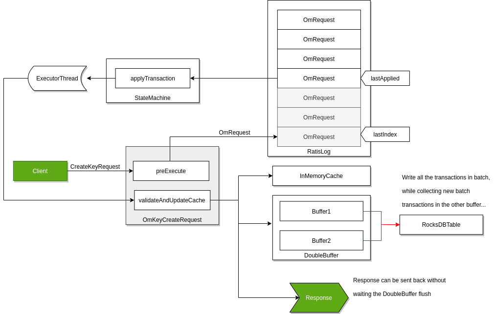

<!---
  Licensed to the Apache Software Foundation (ASF) under one or more
  contributor license agreements.  See the NOTICE file distributed with
  this work for additional information regarding copyright ownership.
  The ASF licenses this file to You under the Apache License, Version 2.0
  (the "License"); you may not use this file except in compliance with
  the License.  You may obtain a copy of the License at

      http://www.apache.org/licenses/LICENSE-2.0

  Unless required by applicable law or agreed to in writing, software
  distributed under the License is distributed on an "AS IS" BASIS,
  WITHOUT WARRANTIES OR CONDITIONS OF ANY KIND, either express or implied.
  See the License for the specific language governing permissions and
  limitations under the License.
-->

Ozone 有两个元数据管理节点（用于键管理的 *Ozone Manager* 和用于块空间管理的 *Storage Container Management* ）以及多个存储节点（数据节点）。数据是借助 RAFT 共识算法在数据节点之间复制。

为了避免任何单点故障，元数据管理节点也应该具备高可用的设置。

Ozone Manager 和 Storage Container Manager 都支持 HA。在这种模式下，内部状态通过 RAFT (使用 Apache Ratis )复制。

本文档解释了 Ozone Manager (OM) HA的高可用设置，请查看[本页]()的 SCM HA。虽然它们可以独立地为 HA 进行设置，但可靠的、完全的 HA 设置需要为两个服务启用 HA。

## Ozone Manager 的高可用

一个 Ozone Manager 使用 [RocksDB](https://github.com/facebook/rocksdb/) 在本地持久化元数据（卷、桶和键）。 Ozone Manager 的高可用版本在功能上完全一致，只是所有的数据都借助 RAFT 共识算法复制到 Ozone Manager 的 follower 实例上。


客户端连接到 Ozone Manager 上，而 Ozone Manager 负责处理请求并且安排复制。当请求持久化到多数投票 OM 的 Raft 日志后，leader 就可以给客户端回包了。

## 容错能力

OM 和 SCM HA 组可以包含三个以上的投票成员。Raft 需要多数投票成员才能选举 leader 并提交请求：

| 投票成员数 | 所需多数 | 可容忍的故障数 |
| --- | --- | --- |
| 2 | 2 | 0 |
| 3 | 2 | 1 |
| 4 | 3 | 1 |
| 5 | 3 | 2 |
| 6 | 4 | 2 |

偶数个投票成员可以工作，但与前一个奇数相比不会增加容错能力。三个投票成员可容忍一个故障；五个可容忍两个，允许在一个节点停机维护时再发生一个节点故障。应将投票成员部署在独立主机上。Listener OM 不计入投票多数，也不会增加容错能力。

## 配置

一个 Ozone 的配置（`ozone-site.xml`）支持多个 Ozone 高可用集群。为了支持在多个高可用集群之间进行选择，每个集群都需要一个逻辑名称，该逻辑名称可以解析为 Ozone Manager 的 IP 地址（和域名）。

该逻辑名称叫做 `serviceId`，可以在 `ozone-site.xml` 中进行配置：

```XML
<property>
   <name>ozone.om.service.ids</name>
   <value>cluster1</value>
</property>
```

对于每个已定义的 `serviceId` ，还应为每个服务器定义一个逻辑配置名：

```XML
<property>
   <name>ozone.om.nodes.cluster1</name>
   <value>om1,om2,om3</value>
</property>
```

对于五个投票成员的组，在 `ozone.om.nodes.cluster1` 中列出 `om1,om2,om3,om4,om5`，并为每个 OM 配置地址。这些 ID 必须对应投票 OM；添加 Listener OM 不会增加容错能力。

已定义的前缀可用于定义每个 OM 服务的地址：

```XML
<property>
   <name>ozone.om.address.cluster1.om1</name>
   <value>host1</value>
</property>
<property>
   <name>ozone.om.address.cluster1.om2</name>
   <value>host2</value>
</property>
<property>
   <name>ozone.om.address.cluster1.om3</name>
   <value>host3</value>
</property>
```

基于 [客户端接口]() ，定义好的 `serviceId` 就可用于替代单个 OM 主机。

例如，使用 `o3fs://`

```shell
hdfs dfs -ls o3fs://bucket.volume.cluster1/prefix/
```

或 `ofs://`:

```shell
hdfs dfs -ls ofs://cluster1/volume/bucket/prefix/
```

## 添加 OM

使用 `ozone om --bootstrap` 添加新的 OM 前，必须在所有现有 OM 的 `ozone-site.xml` 中加入新 OM 的节点 ID、地址和端口。现有 OM 会在收到 bootstrap 请求时重新读取磁盘上的配置，无需重启。

在新 OM 可能成为 leader 之前，还必须更新所有 OM 客户端的 `ozone.om.nodes.<serviceId>` 和对应的 `ozone.om.address.<serviceId>.<nodeId>` 配置，包括 Ozone 客户端、管理工具、S3 Gateway、Recon 和 HttpFS。确保运行中的客户端已加载新配置，必要时重启。仅更新现有 OM 的配置文件并不足够：客户端无法跟随未列入其配置的 leader，参见 [HDDS-17126](https://issues.apache.org/jira/browse/HDDS-17126)。

## Leader 转移

使用 `ozone admin om transfer -id <OM_SERVICE_ID> -n <NEW_LEADER_ID>` 可以手动转移 leader。

在 [HDDS-17124](https://issues.apache.org/jira/browse/HDDS-17124) 修复之前，五节点测试中观察到 OM 和 SCM 的手动 leader 转移命令耗时约 4–13 秒，原因是 Ratis 客户端发现 leader 和重置优先级时的重试等待。这是测试观察值，并非延迟上限，也不是自动故障转移的耗时保证。执行命令时应考虑客户端 RPC 超时；若命令超时，应先检查当前角色再决定是否重试。

## 实现细节

只要请求成功持久化到了大多数节点的 RAFT 日志中，Raft 就可以保证请求的复制。 其中，为了基于 Ozone Manager 实现高吞吐量，即使请求仅持久化到了 RAFT 日志中，它也会立即返回响应。

RocksDB 由后台的批处理事务线程负责更新（这也就是所谓的"双缓冲区"，因为当一个缓冲区用于提交数据时，另一个缓冲区用于收集用于下一次提交的新请求）。这里为了使得当前所有数据对于后续请求都可见，即使后台线程还未完全将其写入，这些键数据也会被缓存在内存中。



尽管在单独的[设计文档]()中介绍了这种方法的细节，但它仍算作是 OM 高可用的组成部分。

## 参考文档

* 查看 [该页面]() 以获取详细设计文档；
* Ozone 的分发包中的 `compose/ozone-om-ha` 目录下提供了一个配置 OM 高可用的示例，可以借助 [docker-compose]() 进行测试。
